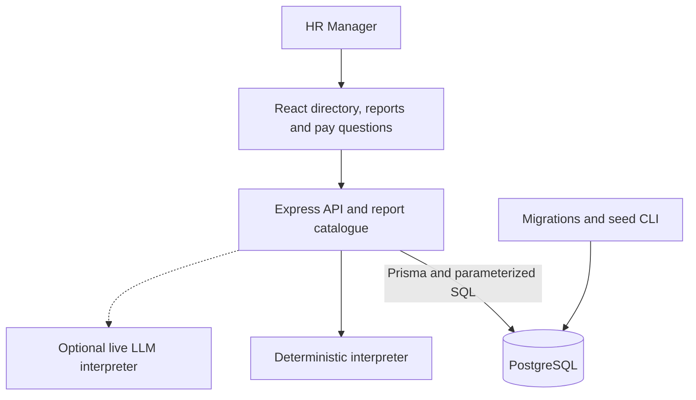

# ACME Salary Management Implementation Plan

**Status** — Revised planning draft  
**Agreed stack** — ReactJS, TypeScript, Node.js with Express, and Prisma with PostgreSQL  
**Starting setup** — Docker Compose and a deterministic pay-question interpreter. Hosted deployment and a live LLM provider are later decisions.

## 1. Requirements and release scope

Use the [one-page requirements draft](docs/requirements.md) as the product scope for review and the first documentation commit before scaffolding. The [technical design](docs/design.md) covers the ER diagram, planned workspace, write contracts, and exact money rules.

**Hosted core.** Sign in, find or add an employee, correct their name, department or level, record an immediate salary revision, and deactivate or reactivate them while retaining their salary history. Verify cohort headcount, total and median annual base salary via the dashboard and confirmed pay questions on the 10,000-employee synthetic dataset.

**Demo extension.** After the hosted core passes its smoke test, add a read-only percentage raise preview with links to the matching directory filters. Include it in the final hosted smoke test and video.

## 2. Decisions and trade-offs

| Area | Proposal | Reason and trade-off |
| --- | --- | --- |
| Frontend | ReactJS + Vite, TypeScript, Material UI Core, React Router, TanStack Query | A client-rendered internal app is enough. URL-backed filters make reports reproducible, and one query cache owns server state. Use a table with server-managed pagination and loading states. |
| Backend | Node.js LTS, Express, TypeScript in strict mode, REST, and runtime schemas such as Zod | Familiar framework with little ceremony. Add explicit input validation, centralized error handling, and authentication middleware. Route handlers validate and authorize, use cases coordinate writes, and query modules own data access. |
| PostgreSQL access | Prisma Client for routine reads and writes, Prisma Migrate for versioned migrations, narrow parameterized SQL for reporting and row locks | A schema-first ORM gives CRUD a typed client. PostgreSQL-specific aggregates and locking remain explicit. Review generated migrations and add database checks and grants in migration SQL where needed. Pin the Prisma and PostgreSQL major versions during scaffolding. |
| Local and hosted setup | Docker Compose first. Build one application image serving the React bundle and `/api` from Express, with PostgreSQL in a separate service and a named local volume. Choose the hosting provider later. | A single origin simplifies cookies. Compose makes local setup repeatable, and the image can later run against managed PostgreSQL using environment configuration. |
| Compensation storage | Keep current salary and one shared employee version on the employee row, with an append-only salary ledger and an independent revision sequence | Current directory and report queries remain simple. A shared version makes a status or profile change visible to a stale salary form. The latest revision always matches current pay. |
| Reporting | PostgreSQL calculates exact metrics on demand with one fixed, labelled FX snapshot | A fixed snapshot keeps results reproducible. It limits the validity of USD numbers to that rate basis. Start with direct queries and use measured latency to justify more indexes, caching, or precomputation. |
| Question interpretation | Deterministic interpreter first, with the same typed contract a future live provider will use. Select the live provider with environment configuration when ready. | Local development and CI need no API key. The fallback supports a documented set of phrases. A live provider would improve coverage of paraphrases and demonstrate runtime LLM integration. Both modes share validation and reporting. |
| Spreadsheet migration | Seed the assessment manually via a CLI. Discuss preview-only CSV import if onboarding from Excel is an evaluation priority. | A real migration requires source mapping, duplicate detection, and row-level error review. The seed provides a complete evaluation dataset without making assumptions about ACME’s workbook. |

Use a small npm workspace with `apps/web` and `apps/api`. Keep the Prisma schema, migrations, and seed with the API. Share contract schemas only where both applications consume them. The directory, reports, and question panel are modules within the same service. The optional live provider has no connection to the database or salary-write paths.

## 3. Salary data, writes, and access

| Entity | Proposed fields and invariants |
| --- | --- |
| `employees` | Unique employee number, display name, country, department, level, active status, fixed salary currency, current annual salary in minor units, and one `version` for profile, status, and salary edits. Enforce required values, valid reference codes, and positive monetary amounts. |
| `salary_revisions` | Employee and actor FKs, independent sequence per employee, prior and new minor-unit amount, currency, reason, UTC timestamp, and request key and fingerprint for salary edits. Enforce uniqueness on employee and sequence, and on employee, actor and request key for submitted edits. |
| `fx_snapshots`, `fx_rates` | Snapshot ID, as-of date, source label, and one positive `NUMERIC` rate to USD for each supported currency. USD has rate `1`. The demo selects one immutable snapshot and labels it synthetic. |
| `hr_accounts`, `hr_sessions` | A demo HR account provisioned through a setup command, a hash of its password, and revocable, expiring server-side sessions. Revisions refer to the account that authenticated the request. |

**Salary representation.** Accept and return exact monetary values as strings in the API. Parse major-unit input to integer minor units and store it in PostgreSQL `BIGINT`. Use TypeScript `bigint` or PostgreSQL `NUMERIC` for exact calculations. The demo supports USD, INR, GBP, and EUR, all with two decimal places in this scope. Validate precision, bounds, and allowed currencies server-side. Keep native amounts as entered and treat USD as a derived reporting amount. [PostgreSQL numeric types](https://www.postgresql.org/docs/current/datatype-numeric.html)

**Add employee.** Insert the employee and initial salary revision in one transaction. The unique employee number protects against duplicate creation. If a submission appears to time out, offer a lookup by the same employee number so HR can confirm what was saved.

**Correct profile or status.** Allow `displayName`, `departmentCode`, `levelCode`, and `active` in `PATCH /api/employees/:id`. Compare `expectedVersion` under the same employee row lock used by salary revisions. Apply the change and increment the employee version together. Profile and status updates leave pay and the salary ledger untouched. Deactivation removes the employee from active reports and prevents new salary revisions until reactivation.

**Revise salary.** Within a short Prisma transaction, lock the employee row. Check the request key and canonical payload before checking the shared employee version and active status. A matching replay returns the original revision. For a new request, compare `expectedVersion` and verify that the employee is active and the salary has changed. Append the next ledger `sequence` and update current pay and the employee `version` together. Stale edits get a `409` and HR can reload the latest profile. Reuse the original key on a network retry. Limit the application database role to inserting and reading revisions, with a separate role for migrations. [Prisma transactions](https://www.prisma.io/docs/orm/fundamentals/transactions) · [Parameterized Prisma queries](https://www.prisma.io/docs/orm/v7/prisma-client/using-raw-sql/raw-queries) · [PostgreSQL row locking](https://www.postgresql.org/docs/current/explicit-locking.html)

**Access.** Require an authenticated HR session on every employee, reporting, and pay-question API route. Use a `Secure`, `HttpOnly`, `SameSite` session cookie in the hosted app, expiry and logout revocation, and origin checks on authenticated state-changing requests. Keep login and LLM request limits server-side, provision credentials outside Git, and send reviewers access separately from the public repository. The deployment contains synthetic data. Exclude salary values, raw questions, revision reasons, and session tokens from operational logs. Keep the salary revision ledger available through authenticated employee history.

## 4. Reports and natural-language questions

### Shared reporting rules

| Report field | Definition |
| --- | --- |
| Population | Same validated filters for dashboard and pay questions. Active employees by default. A matching employee contributes once. All measures use current salary. |
| Headcount | Count of matching employees. |
| Total annual base salary | Sum of annual salary amounts. Multi-currency totals use USD normalization. Label it as annual base salary, since payroll costs include items outside the model. |
| Median | Order exact minor-unit values. Use the middle value for odd counts and the half-up rounded mean of the two middle values for even counts. Empty cohorts show a count of zero and no median. |
| Currency and rounding | Show native pay for an explicitly single-currency cohort. Use USD throughout grouped comparisons so rows share a currency. For USD figures, multiply native minor units by the selected snapshot rate, round each converted employee amount to a USD cent using half-up rounding, then calculate the aggregate. Include the basis, FX date, and synthetic source label. A missing rate produces an explicit report error. |

See the [money rules and fixtures](docs/design.md#exact-money-and-reporting) for the exact calculation and rounding examples.

### Raise-cost preview

Preview a percentage raise for a filtered cohort of active employees. Round each projected salary half-up in its native minor units, then apply the same reporting currency and FX snapshot rules as the dashboard. Return cohort headcount, current spend, projected spend, and their difference, with a link to the matching directory filters. The endpoint is read-only. See the [preview contract](docs/design.md#read-only-raise-cost-preview).

### Ask about pay

1. HR enters a current aggregate question or chooses an example. The browser sends text to the authenticated API. Bound its length and rate, reject obvious identifiers such as email addresses and employee numbers, and offer aggregate examples. Free text can still contain sensitive material, so a real-data rollout requires a separate decision on external provider use.
2. Implement the deterministic interpreter first. Map supported questions and common synonyms to a report intent, a request for clarification, or an unsupported-question result. Show the active mode and example prompts in the UI. Local setup and CI use this mode with zero provider calls. Reserve a narrow adapter boundary for a live provider. Adding live mode later requires implementing and testing its adapter. Once that is in place, environment variables select the mode and supply the provider key. Use schema-constrained output and send only question text and the approved reporting vocabulary with synthetic lookup labels. OpenAI Structured Outputs is one option to verify when selecting a provider. [OpenAI Structured Outputs](https://developers.openai.com/api/docs/guides/structured-outputs)
3. Validate every returned metric, filter and grouping on the server, regardless of interpreter mode. Reject unknown values and unsupported combinations. For example, “Which department pays the most?” prompts HR to choose total annual base salary or median salary. Employee-specific questions, requests to change pay, and pay history trends route to an explanation of the supported reports or the employee directory.
4. Show the interpreted metric, cohort, grouping, and currency basis for HR to confirm. Confirmation calls the same reporting endpoint used by the dashboard. Build SQL from a fixed catalogue with bound values. Render figures from the validated result using application templates. Link to the equivalent dashboard or directory filters. When the raise preview is available, a supported question confirms the cohort and percentage before calling the same preview endpoint as the form.
5. Keep direct report filters usable for unsupported questions and interpretation failures. With live mode enabled, handle refusal, invalid output, timeouts, and provider configuration errors. Offer deterministic examples when the live provider is unavailable and label the mode used. Verify the live provider with synthetic questions if it is enabled for submission.

**Initial report catalogue.** Headcount, total annual base salary, and median, with filters and optional grouping by one of country, department, or level. This covers meaningful HR questions and keeps answers traceable to the dashboard. The interpreter returns only a reporting intent. Salary writes run through a separate authenticated flow.

## 5. API and UI slices

| API | UI and observable behavior |
| --- | --- |
| `POST /api/session`, `DELETE /api/session`, `GET /api/session` | Sign in, sign out, and restore an existing HR session. |
| `GET /api/employees`, `GET /api/lookups` | Directory search, explicit sort allowlist, active-status and cohort filters, bounded page size, and a stable employee-ID tie-breaker. Keep filters in the URL and reset the page when filters change. |
| `POST /api/employees`, `GET /api/employees/:id` | Add an employee with initial pay and open the detail view with native annual salary, the current employee version, and chronological revision history. |
| `PATCH /api/employees/:id` | Correct profile details or deactivate/reactivate using the shared version. Refresh employee detail, directory, and reporting after a successful change. |
| `POST /api/employees/:id/salary-revisions` | Show existing and proposed pay, collect a reason, confirm the edit, then refresh detail and report data. Give distinct feedback for invalid input, a stale edit, and a successful save. |
| `GET /api/reports/compensation` | Overview and grouped table with visible report definitions, empty states, and the FX basis. Use the same visible definitions for results opened from Ask about pay. |
| `POST /api/reports/raise-cost-preview` | Preview the cost of a percentage raise for an active cohort. Show comparable current and projected spend, the difference, and the matching directory link. |
| `POST /api/pay-questions/interpret` | Show the interpreter mode, supported examples, the intended report before execution, and recovery options for ambiguous questions or an unavailable live provider. |

Prioritize the reporting table and employee edit form before adding charts. Use clear field labels, keyboard navigation, visible focus and error states, and the same currency labels in table, detail, and analytics views. Keep date, currency, and active-status assumptions visible where they change the meaning of a figure.

## 6. Seed, tests, and performance evidence

**Seed.** Use a fixed generator seed and a fixed reference date. Generate exactly 10,000 clearly synthetic employees across the US, India, the UK, and Germany, with uneven country and department sizes, several job levels, a small inactive cohort, and coherent salary histories. Use stable employee numbers and assert that each latest revision matches current pay. Supply documented demo records that are easy to find during the video. Run seeding as an explicit setup task. Commit a seed marker in the same transaction as the data, make reruns with the same seed version a no-op, and refuse to seed an unexpected populated database. Run routine app restarts without reinitializing data.

| Layer | Verification and evidence |
| --- | --- |
| Domain unit tests (Vitest) | Exact parsing and formatting, precision and bounds, invalid and unchanged salary edits, even/odd/empty median cases, native and FX preview rounding, intent allowlist, and deterministic answer rendering. Use fixed fixtures and clock values. |
| API and PostgreSQL integration tests | Use Supertest against Express and disposable PostgreSQL with real Prisma migrations. Cover unauthorized access, stable directory paging, opening history, rollback, concurrent writes from one version, and safe or conflicting retries. Test a salary request racing with deactivation, a profile edit leaving the ledger intact, reporting after reactivation, missing FX, and a raise preview that matches dashboard current spend and creates zero writes. |
| React tests and browser smoke (Testing Library and Playwright) | Exercise sign-in, directory filtering, salary revision persistence after reload, deactivate/reactivate and report inclusion, and matching dashboard and pay-question results. Verify the preview and its cohort link after the hosted core. Run a separate hosted smoke test for the live provider if enabled. |
| Question interpretation checks | Save a versioned set of synthetic questions with expected intents. Cover supported wording, ambiguous metrics, unknown groups, employee-specific requests, write requests, and input that asks to override the catalogue. Test the deterministic mode in CI. If live mode is enabled, measure paraphrase accuracy and incorrect acceptance separately. |
| Performance checks | On the full seed, measure p50 and p95 for filtered directory requests and overall/grouped reports. Record hardware or hosting tier, sample count, concurrency, warm-up, and query plans. Measure LLM latency separately. Treat targets as investigation thresholds for the assessment, with results measured and reported once deployed. |

Proposed performance targets are warm p95 under 250 ms for directory API calls and under 500 ms for PostgreSQL-backed reports, measured without the LLM at five concurrent sessions on the seeded deployment. Start with the unique employee number and the `(employee_id, sequence)` history index. Examine `EXPLAIN (ANALYZE, BUFFERS)` for representative filters, the stable page sort, and grouped reports before adding composite indexes or trigram search. Bound request and response sizes. Keep CI deterministic by avoiding wall-clock performance assertions on shared runners. [PostgreSQL aggregate functions](https://www.postgresql.org/docs/current/functions-aggregate.html)

## 7. Agentic development and assessment evidence

The developer sets scope, approves reporting rules and API contracts, and reviews each diff. Give the coding agent one bounded slice at a time and ask for the tests and observed output. Use a separate review pass on high-risk areas once the diff is available. Commit the developer’s acceptance of each slice through working tests and a concise rationale where the decision matters.

| AI task | Example instruction and evidence |
| --- | --- |
| Design critique | “Review the salary revision flow for races, partial writes, and identical retries. Return failing scenarios and suggested assertions.” Add a real discovered case to the design notes or tests and record how it was resolved. |
| Bounded implementation | “Implement the approved revision contract and PostgreSQL tests for one winning update, one stale edit, and a safe retry. Explain failures with observed output.” Review lock scope, input validation, and error handling before committing. |
| Reporting and model evaluation | “Given these formulas and allowed dimensions, propose paraphrases, ambiguities, unsupported questions, and exact synthetic test inputs.” Calculate fixture expectations independently. Run deterministic tests and a separate live evaluation if the provider is enabled. |
| Final review | “Compare the candidate against the requirements and deployed smoke run. Cite file paths and test evidence for gaps.” Resolve reproducible issues and record remaining trade-offs. |

Keep representative sanitized prompts and actual review outcomes in `docs/ai-workflow.md`, including what was accepted, corrected, or discarded and how correctness was checked. Capture the chosen design and alternatives in `docs/design.md`, and include benchmark commands and measured results in `docs/performance.md`. The README links the one-page requirements, plan, design, evidence, deployed app, and demo video, with setup and reviewer access instructions.

## 8. Incremental delivery and future commits

| Step | Candidate commit | Evidence at the end of the step |
| --- | --- | --- |
| 1 | `docs: define ACME salary management requirements and design` | The one-page requirements, ER diagram, and exact write and money rules are reviewed before scaffolding. |
| 2 | `chore: scaffold React and Express with Docker Compose` | A fresh local Compose run starts the app and PostgreSQL. Type checks and a smoke test run in CI. |
| 3 | `feat: add Prisma schema and deterministic 10k seed` | Prisma migrations run from an empty PostgreSQL database and the seed is verified and safe to rerun. |
| 4 | `feat: authenticate HR and browse the employee directory` | Sign-in, search, paging, and employee detail work through UI and API. |
| 5 | `feat: maintain employee profiles and record salary revisions` | Add employees, correct profile fields, deactivate/reactivate, and record salaries. Tests show that staff and salary edits share one version and leave the ledger consistent. |
| 6 | `feat: report compensation by country, department and level` | Known multi-currency figures agree with SQL fixtures and dashboard results. |
| 7 | `feat: interpret pay questions with validated reporting intents` | Deterministic questions produce the same figures as the dashboard. If a live provider is selected, add its adapter and evaluation in a separate commit. |
| 8 | `chore: package and verify the hosted core` | Verify the 10,000-employee workflow on the host from sign-in through salary change, reload, deactivation and reactivation, including dashboard and question parity. |
| 9 | `feat: preview raise costs for an active cohort` | Check native and USD math, report parity, directory filters, and zero writes. Repeat the hosted smoke test with the preview. |
| 10 | `docs: record release verification, performance and demo` | Document measured performance, representative AI evidence, final hosted smoke results, and the video link. |

Each change should be independently reviewable and leave existing checks green. Add tests with their corresponding slices. These are planned commits for the implementation phase.

## 9. Deployment, demo, and submission

1. Prove the full app locally first. Use Compose for the app and PostgreSQL, a database readiness check, and documented one-time Prisma migration, seed, and HR account commands. Commit a sample configuration with placeholders. Rebuild and restart the app to verify data persists. [Docker Compose documentation](https://docs.docker.com/compose/)
2. Choose the host once the local end-to-end flow works. Render is one option for the application image and managed PostgreSQL. Run reviewed migrations as a release step and seed once. Configure database and HR secrets, plus a provider key if live mode is selected. Verify sign-in, employee lookup, salary revision persistence, deactivate/reactivate, and reports in a fresh browser before adding the preview. Record the release commit and smoke results. [Render web services](https://render.com/docs/web-services) · [Render PostgreSQL connectivity](https://render.com/docs/postgresql-creating-connecting)
3. Verify the hosted preview and record a 3–4 minute demo. Show the seeded directory, an auditable salary change, agreement between a pay question and the dashboard, and the estimated cost of a 5% raise for Engineering in India. Open the matching cohort from the preview. Include test and measured performance evidence.
4. Once the deployed app and video have been verified, include the hosted URL, video, and setup instructions in the repository. The final submission is a reply to the original assessment email with the repository link and evaluator access instructions.

## 10. Discussion before implementation

| Decision | Proposed starting point | Why it matters |
| --- | --- | --- |
| Excel onboarding | Defer CSV import. If required for assessment, consider an import preview with validation before enabling writes. | Affects how convincingly the app replaces the first spreadsheet and can add significant reconciliation work. |
| Salary workflow | Add employees, correct profile information, deactivate/reactivate, and record immediate salary revisions. Defer bulk and scheduled changes. | Covers routine employee maintenance and protects compensation history through one version check. |
| Reporting | Use USD for comparisons and one fixed synthetic FX snapshot. Use native amounts for a single-currency cohort. | Sets consistent expectations for totals and as-of claims in the demo. |
| Live LLM before submission | Keep deterministic mode for the first build. Add a live provider before submission if runtime LLM integration is expected for the role or is a feature you want the demo to showcase. | The brief explicitly requires agentic AI use during development. A deterministic interpreter demonstrates the product workflow, while a live adapter with measured evaluation demonstrates model integration. |
| Hosting and access | Choose hosting after the local vertical slice works. Reserve time to provision PostgreSQL, verify a stable URL, and arrange evaluator access. | The brief explicitly requires a deployed app and video. A repeatable Compose setup supports the review and local reproduction. |

**Potential follow-ups.** Prioritize import with a validate-and-preview flow if adoption is blocked by spreadsheets. Add enterprise SSO and scoped permissions before a real-data rollout. Introduce effective-dated salary and assignment history when finance needs as-of reporting, and add reviewed FX snapshots when rate freshness matters. Use measured load or query evidence to justify targeted indexes or precomputed reports.
