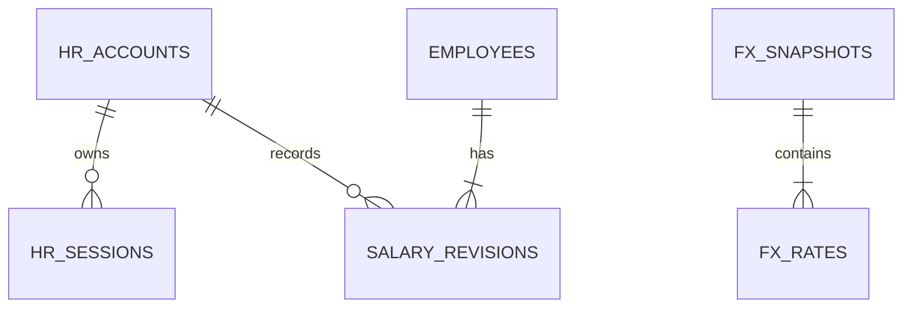

# ACME Salary Management Design

Draft for review. The product scope is in [requirements.md](requirements.md). The delivery sequence is in [ImplementationPlan.md](../ImplementationPlan.md).

## Architecture and planned workspace

Use React and TypeScript for the HR UI, Express for authenticated REST endpoints, and Prisma with PostgreSQL for data access. Serve the built UI and API from one origin. Use Prisma for ordinary reads and writes, with parameterized SQL for row locks and exact reporting queries. The deterministic question interpreter proposes a report or preview intent. The API validates it and the UI asks HR to confirm it. A future live provider can implement the same contract. The report and preview services compute their own results and the UI renders them using templates.

```text
SalaryManagement/
  ImplementationPlan.md
  README.md
  compose.yaml
  package.json
  apps/
    web/
      src/                  # Employee directory, details, reports, and question panel
    api/
      src/                  # Routes, use cases, report queries, and interpreter
      prisma/              # Schema, versioned migrations, and deterministic seed
  docs/
    requirements.md
    design.md
    ai-workflow.md         # Representative prompts and verified review findings
    performance.md         # Query plans and measured endpoint timings
```

Share contract schemas between the API and UI where both consume them. Keep browser tests alongside the web app and PostgreSQL integration tests alongside the API. The tree describes the intended repository after implementation.

## Data model



| Entity | Keys and invariants |
| --- | --- |
| `employees` | Primary key `id` and unique employee number. Holds display name, country, department, level, `active`, fixed native currency, current annual base salary as `BIGINT` minor units, and one `version` for all writes. Validate country, department, and level against controlled reference values. |
| `salary_revisions` | Foreign keys to employee and actor. Unique `(employee_id, sequence)` orders the ledger. Record previous and new salary, currency, reason, UTC timestamp, and a request key and fingerprint for salary edits. Unique `(employee_id, actor_id, request_key)` protects edits from duplicate submission. The opening revision has sequence 1 and no previous amount. Synthetic histories use a disabled system account for attribution. |
| `hr_accounts`, `hr_sessions` | Identify HR actors and hold revocable, expiring server-side sessions. Hosted sessions use a `Secure`, `HttpOnly`, `SameSite` cookie. Store reviewers’ credentials outside Git and give the app and migrations separate database roles. |
| `fx_snapshots`, `fx_rates` | A snapshot has an ID, date, and source label. Rates use a composite key `(snapshot_id, currency_code)` and an exact positive `NUMERIC` rate to USD. USD has rate 1. The demo uses one immutable, labelled synthetic snapshot. |

## Employee changes and concurrency

**One employee version.** Employee detail returns `version`. Both `PATCH /api/employees/:id` and `POST /api/employees/:id/salary-revisions` require `expectedVersion`. Every successful change to profile, active status, or salary increments the same `version` once. Salary `sequence` advances only when a salary revision is recorded. Read the latest ledger sequence under the employee row lock and rely on its uniqueness constraint. An employee may have version 5 with only two salary revisions.

| Operation | Write contract |
| --- | --- |
| Create employee | Insert the employee and opening salary revision in one transaction. A duplicate employee number returns a conflict. A client recovering from a timed-out create can look up that employee number. |
| Correct profile or status | `PATCH` allows `displayName`, `departmentCode`, `levelCode`, and `active` plus `expectedVersion`. Acquire the employee row lock, compare the version, and update only allowed fields. A valid request at the current version that changes no values returns the current record. This path leaves salary data and the salary ledger untouched. |
| Revise salary | The request contains the decimal amount, reason code, expected version, and unique request key. Lock the employee row inside a short Prisma transaction. Look up the request key for this actor and employee before checking version or status. Compare a fingerprint of the parsed minor-unit amount, normalized reason, and expected version. A match returns the original committed revision. A mismatch returns `409`. For a new request, verify version, active status, and a changed amount. Append a revision, update current pay, and increment the employee version in the same transaction. Use the transaction client for every read and write in this sequence. |

Use a consistent lock order starting with the employee row. For example, when deactivation wins from version 4, it takes the record to version 5. A fresh salary edit submitted from version 4 returns `409` without appending a revision. A new salary request against version 5 also fails while the employee is inactive. Replaying a previously committed salary request returns its original result without a new write, even after deactivation. If salary wins first, the stale deactivation request returns `409`, and HR can review and retry. Reactivation preserves salary and history and restores eligibility for new salary changes and active reports.

Keep the app database role limited to `SELECT` and `INSERT` on `salary_revisions`. Resolve stale forms by showing current data and asking HR to review. Refresh employee detail, directory and report data after a successful mutation. The current salary must always match the latest ledger entry.

## Exact money and reporting

| Rule | Design |
| --- | --- |
| Amounts | Accept and return major-unit decimal strings with explicit currency. Parse to native integer minor units and store as PostgreSQL `BIGINT`. Do exact arithmetic using `bigint` or `NUMERIC`, including intermediate sums and multiplication. USD, INR, GBP, and EUR each use two decimals in the demo. Validate input precision and storage bounds. |
| Cohort | Dashboard reports, pay questions, and raise previews use shared, validated country, department, and level filters. Reports default to active employees. Each matching employee contributes once. |
| Currency basis | Use native currency when filters establish a single currency. Use USD for multi-currency totals and grouped comparisons. Convert each employee’s minor-unit amount with the selected snapshot’s rate, then round half-up to one USD cent before aggregating. This formula assumes the supported currencies’ equal minor-unit scale. Include the snapshot ID, date, and synthetic source label when converting. Display the native currency and indicate when conversion is unnecessary. Missing rates fail the USD calculation explicitly. |
| Median | Order exact minor-unit values and select the middle rank or ranks using row number and cohort count. For even counts, compute the mean of the middle two in `NUMERIC` and round half-up to one minor unit. Display no median for an empty cohort. The same rounding applies to native and converted amounts. |

For a reporting fixture, USD 60,000, USD 80,000, and INR 4,000,000 at `0.0125` USD per INR give **USD 190,000** total and **USD 60,000** median. An India-only report gives **INR 4,000,000** median. For an even cohort, USD 100.00 and USD 100.01 give a median of **USD 100.01**.

## Read-only raise-cost preview

`POST /api/reports/raise-cost-preview` takes the common cohort filters and `raisePercent` as a positive decimal percentage string, such as `"5"`. Accept up to two fractional digits. Validate amount bounds and fix the cohort to active employees. The API serves a calculation, with zero employee or salary ledger writes. Use a single read query so headcount, current spend and projected spend reflect the same cohort and salary values for that preview.

1. Select the active cohort and determine the currency basis using the dashboard’s report rules.
2. Calculate each projected salary as `current native minor units × (1 + raisePercent / 100)`. Round half-up to one native minor unit before conversion.
3. For USD results, convert and round each employee’s current and projected amount independently using the same FX snapshot as the dashboard. Sum each column. Calculate the displayed difference as `projected spend − current spend` after summing.
4. Return headcount, current spend, projected spend, difference, currency, FX basis, and an **Open matching employees** link with the validated directory filters and active status. A later visit to the directory evaluates those filters against current data. For an empty cohort, show zero spend and an empty-cohort message.

**Fixtures.** A 5% raise on INR 4,000,000 produces INR 4,200,000 and a difference of INR 200,000. A 5% raise on 100.10 in native currency produces 105.11. For a mixed-cohort rounding test, INR 4.25 at the example rate converts to USD 0.05, and its 5% projected native amount of INR 4.46 converts to USD 0.06. The reported delta for that row is USD 0.01. Tests should verify that previewing twice leaves both employee versions and ledger rows intact.

## Verification at the design boundaries

| Area | Evidence |
| --- | --- |
| Writes | PostgreSQL integration checks for rollback, concurrent salary updates, profile or status versus salary races, unchanged profile requests, duplicate salary requests, and reactivation with salary history intact. |
| Reporting | Exact even, odd and empty median fixtures, multi-currency rounding, missing FX, and inclusion changes after deactivate/reactivate. |
| Preview and deep links | Native and mixed-currency fixtures, empty cohort, invalid percentage, report parity for current spend, filter parity with the directory link, and zero writes. Where question interpretation offers a raise preview, confirm the parsed cohort and percentage before calling the same preview endpoint. |
| Review path | Playwright smoke through sign-in, lookup, salary save, reload, deactivation, and reactivation. Verify the hosted core before adding the preview, then repeat the smoke with the preview before recording the demo. |

## Implementation clarifications and resolved discrepancies

Recorded before scaffolding so all three planning documents align on exact behavior:

1. **Shared contracts package.** Both `docs/design.md` and `ImplementationPlan.md` recommend an `apps/web` + `apps/api` npm workspace while sharing contract schemas where both apps consume them. We place shared Zod schemas, reference-code enums, and exact money parsing/formatting helpers in `packages/contracts` inside the same workspace.
2. **Single-currency vs. grouped reporting basis.** Ungrouped reports filtered to a single country return native currency with no FX conversion (`India-only` → `INR`). Multi-country overviews and all grouped comparisons (`groupBy` = `country`, `department`, or `level`) normalize to USD using the active synthetic FX snapshot so every comparison row shares one currency.
3. **Session TTL and local cookie security.** Server-side sessions in `hr_sessions` expire 8 hours after creation (`expires_at`) and support immediate logout revocation (`revoked_at`). Cookies are always `HttpOnly` and `SameSite=Lax`; `Secure` is enabled by default (`COOKIE_SECURE=true` in production HTTPS) and relaxed only for local `http://localhost` Docker Compose verification. Authenticated state-changing routes validate `Origin` / `Referer` against the configured app origin.
4. **Database role separation.** Prisma migrations and the seed CLI connect with the owner role (`MIGRATION_DATABASE_URL`), while the Express API connects with a restricted runtime role (`DATABASE_URL`, `acme_app`) limited to `SELECT` and `INSERT` on `salary_revisions` so the database itself enforces an append-only ledger.
5. **Hosting gate for Step 9.** Per `docs/requirements.md` and `ImplementationPlan.md`, the read-only raise-cost preview is added only after the hosted core is verified; if hosting credentials are absent in the local environment, delivery pauses after Milestone 8 with full local verification, deployment configuration, and the exact hosting dependency documented.
